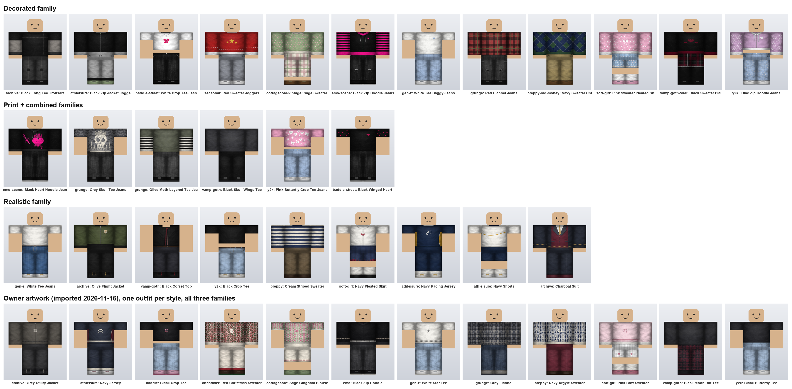
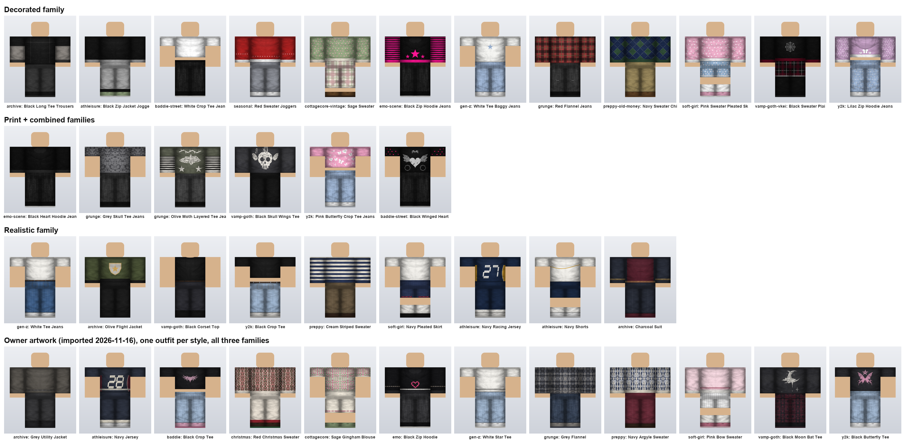

# Style guides

One guide per focus style. Each one says who the style is for, the exact spec settings, the palette, what can be drawn today, the trend words to name it with, its moderation traps, and a validated example outfit you can copy.

Each style also has a reference sheet of original motifs and patterns in [../references/](../references/README.md).

| Guide | Audience | Catalog evidence (2026-11-16) | Example |
|---|---|---|---|
| [Gen Z everyday](gen-z.md) | unisex | basics 18 + hoodie sets 13 | [gen-z](examples/gen-z.yaml) + [golden](../../golden/) |
| [Y2K](y2k.md) | fem / unisex | #1, 54 hits | [y2k](examples/y2k.yaml) |
| [Vamp / goth / vkei](vamp-goth.md) | fem / unisex | #2, 37 hits | [vamp-goth](examples/vamp-goth.yaml) |
| [Emo / scene](emo.md) | unisex | #3, 33 hits | [emo](examples/emo.yaml) |
| [Baddie](baddie.md) | fem | #4, 27 hits | [baddie](examples/baddie.yaml) |
| [Grunge](grunge.md) | masc / unisex | #5, 23 hits | [grunge](examples/grunge.yaml) |
| [Christmas and winter](christmas.md) | unisex | 12 seasonal + 11 cozy | [christmas](examples/christmas.yaml) |
| [Preppy / old money](preppy.md) | masc / fem | 10 hits | [preppy](examples/preppy.yaml) |
| [Soft girl / coquette](soft-girl.md) | fem | 9 + kawaii 8 | [soft-girl](examples/soft-girl.yaml) |
| [Cottagecore](cottagecore.md) | fem | 7 hits | [cottagecore](examples/cottagecore.yaml) |
| [Athleisure](athleisure.md) | masc / unisex | steady basic | [athleisure](examples/athleisure.yaml) |
| [Archive](archive.md) | masc | not in catalog yet (niche bet) | [archive](examples/archive.yaml) |

Every example renders and passes `validate.py`. They are included in `python tools/run_tests.py`.

## Three design families
- **Decorated** (approved, keep using it): small motifs, patterns and trims on chest, pocket, sleeve, thigh, hems and so on. The 12 `examples/<style>.yaml` outfits are the reference.
- **Print**: one large composition that dominates the torso front or back (optionally wrapping onto the sides), one ink in 2-3 tones, with distress (drips, splatter, scratches, halftone fade, cracked ink, worn patches) on washed fabrics (`acid_wash`, `mineral_wash`, `heather`, `faded_black`). References: `examples/print-*.yaml`.
- **Combined**: a print plus small decorated motifs (e.g. back print + sleeve hearts), within the palette limit. Reference: `examples/combined-baddie.yaml`.
- **Realistic**: garments that read as real clothes: material textures (cotton, knit, denim, leather, satin, nylon), fold maps per garment, sewn construction parts (collars, lapels, ties, waistcoats, zips, plackets, pockets, belts, jeans stitching, cuffs, trims, piping), shaped cut-outs, detailed shoes, numbers and invented emblems. Nine archetypes in `tools/recipes.py`; references: `examples/realistic-*.yaml`. Shading: the owner's three templates stacked (`own-shade-all`, the default for every family) over procedural material texture and lighter folds; see `templates/shading/custom/` and [LICENSES.md](../references/LICENSES.md).
- A spec declares `family: decorated | print | combined | realistic`; the validator checks it matches the outfit. Any family may borrow `parts`, `identity`, `shoe_style` and a collected `shading.layer`.
- Separates: `coverage: top_only` or `bottom_only` renders one file sold alone as `<words> Top` / `<words> Pants`.
- Both families draw from one [element library](../references/library/INDEX.md) (121 elements, tagged by style, mood, size and family). Ask for designs by **recipe** (style, family, template, 2-5 tags, ink, distress, seed); see `tools/recipes.py`.

## Mixing a batch for a mass audience
1. At least half the batch from the top 5 (Y2K, vamp/goth, emo, baddie, grunge) plus gen Z basics.
2. At least one masc, one fem and one unisex outfit in every batch of 4 or more.
3. One seasonal outfit per batch from mid-November to December.
4. Archive and cottagecore at most one each per batch until sales data shows they sell.
5. Never two outfits from the same guide with the same palette in one batch; use that guide's "Variations" list.
6. Mix all three families in every batch: roughly a third each of decorated, print/combined and realistic, unless sales data in `trends/` says otherwise. Every outfit in every family is shaded with `own-shade-all` (the owner's three templates stacked); no two realistic outfits share an archetype **and** a shading seed.
7. Front first (owner note, 2026-11-16): every new outfit's main graphic goes on the front (front print or chest graphic); a back graphic is at most a secondary accent. Existing back-print examples stay approved.
8. Within a style, no two outfits in a batch share the same template **and** the same main element.
9. Before choosing recipes, run `python tools/recipes.py suggest --style <style>` (add `--family realistic` for archetype x shading ideas) and prefer combinations not yet in [trends/recipe-log.csv](../../trends/recipe-log.csv); every rendered store spec is logged there automatically.
10. Once `trends/*-own-sales.md` exists, shift the mix toward the family, styles and main elements that sell, and note the shift in the batch proposal.
11. `validate.py` rejects near-duplicates of any spec already in `specs/`; change the template, main element, ink or seed rather than nudging colours.

## Decorations
Every section (torso, arms, legs) takes a `decor` list of original motifs: butterfly, star, sparkle, heart, flame, bat, lightning, moon, bow, rose, web, flower, stud, cherry, plus chain, rip, patch, stitch, lace and safety pin, placed with layouts like chest, pocket, back, sleeve, scatter, row, knees and hip_chain. Patterns now include argyle, cable, leopard and checker. Each guide's Decorations section says which ones fit.

## Renderer backlog (details these styles want but cannot be drawn yet)
Done: rips, chains, small prints (stars, hearts, bows, snowflake sparkles), lace trim. Still missing, ranked by how many guides would use them; until they exist, guides list them under "Not drawable yet" and Codex must flag them instead of faking them.

| Detail | Guides that need it |
|---|---|
| Flared / wide legs | y2k, vamp-goth, archive |
| Ruffle trim | vamp-goth, soft-girl, cottagecore |
| Leg warmers, fishnet-free mesh look | baddie, soft-girl, y2k |
| Puffer quilting, fur trim, hoods with lining folds in the realistic family | christmas, archive, athleisure |

Done in the realistic family: cargo pockets, polo / shirt collars, plackets, blazer lapels, ties, waistcoats, corset-style lacing, shorts, detailed sneakers / boots / loafers.
